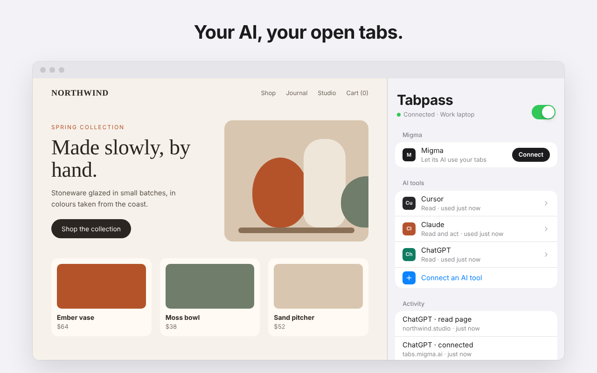

# Tabpass

**Your AI, your open tabs.** Tabpass lets Claude, ChatGPT, Cursor, Codex, Migma or any other MCP client read and use the Chrome tabs you already have open, signed in as you. You approve each new site.

Open source (MIT), by the [Migma](https://migma.ai) team.

<p align="center"></p>

It follows the structure of OpenAI's ChatGPT Chrome extension: a side panel, per-site approval, a tab group per tool, and read vs act. The difference is that the browser is reached through a **remote MCP server**, so any AI tool can use it, from anywhere.

```
 AI tools ── MCP over HTTPS ──┐   websites ── Tabpass Web Protocol ──┐   Migma ── server to server ──┐
 one URL, OAuth sign-in        │   (connect in one click)            │                                │
                               ▼                                      ▼                                ▼
                     relay/   tabs.migma.ai: Cloudflare Worker (or Node), MCP + OAuth + /internal
                                │  a WebSocket the browser opens outward (works behind any NAT)
                                ▼
                     extension/   Chrome MV3: side panel, site approval, 15 tools
```

## Connect any AI tool

Every tool uses **one link**: `https://tabs.migma.ai/mcp`.

1. Add the link to your tool as a remote MCP server. In the side panel, **Connect an AI tool** has an **Add** button for Claude, Cursor and VS Code, and short steps for 16 others.
2. The tool asks you to sign in. Tabpass opens its own window: pick **Read** or **Read and act**, then **Connect**.
3. The first time the tool wants a site, Tabpass asks: **Always allow**, **Allow for 10 minutes**, **Don't allow** or **Block this site**.

The relay is an MCP OAuth 2.1 server, so tools register and sign in by themselves (Dynamic Client Registration or Client ID Metadata Documents, PKCE). No token to copy.

For tools that cannot sign in, **Make a link with a key** gives a link with its own token, as a URL, a header or a config snippet.

Step-by-step guides for 19 tools: [docs/clients.md](docs/clients.md). Agents that read docs can start at `https://tabs.migma.ai/llms.txt`.

## Four ways in

| | How | Who it acts as |
|---|---|---|
| **One URL** (OAuth) | Add `https://tabs.migma.ai/mcp`, approve in Tabpass's window | The tool's name, with the access you picked |
| **Link with a key** | **Make a link with a key** in the side panel | The name you typed |
| **Website** | The site's "Connect your browser" button, then confirm in Tabpass | The site's name; it gets a token for its AI ([web protocol](docs/web-protocol.md)) |
| **Migma account** | **Connect** next to Migma in the side panel | Migma, for the person signed in to Migma |

Account mode is built for teams: a browser binds to one **person**, never to an org, so teammates, admins and org-wide keys can never reach someone else's browser. See [docs/migma-integration.md](docs/migma-integration.md) for Migma's side and every edge case, and [docs/accounts.md](docs/accounts.md) to add another provider.

## Tools

| Tool | Level | What it does |
|---|---|---|
| `list_tabs` | read | Tabs in every window: id, title, URL, active, groups. Blocked sites are hidden. No prompt. |
| `read_page` | read | Clean text (headings, lists, links, tables). `interactive=true` adds buttons and fields with refs. Google Docs and Sheets are read through their export. |
| `get_selection` | read | The text the person highlighted. |
| `screenshot` | read | Visible part of a tab as JPEG or PNG. |
| `extract_design` | read | Palette with roles, fonts, type scale, button styles, radii, content width, logo, key images. |
| `wait_for` | read | Wait for a load, or for text to appear. |
| `open_tab`, `navigate`, `activate_tab`, `close_tabs`, `group_tabs` | act | Tab management. Opened tabs go into the tool's own tab group. |
| `click`, `type`, `press_key`, `scroll` | act | Act by ref, CSS selector, or visible text. |
| `list_browsers` | account | A person's connected browsers. Other tools take `browser` to pick one; the default is the one used last. |

Every page result starts with a line marking the content as untrusted, and the server instructions tell tools never to follow instructions found in pages.

## Repository

```
relay/        TypeScript relay. src/core runs on Web APIs only, shared by both hosts:
                src/worker   Cloudflare Worker + Durable Objects (production, tabs.migma.ai)
                src/node     Node server and CLI (self-hosting, Docker, tests)
extension/    public/  service worker, tools, page agent, web protocol bridge, manifest (plain JS)
              src/     side panel and prompt windows: React 19, Tailwind v4, shadcn/ui
e2e/          real Chromium end to end, and the store image generator
store/        Chrome Web Store listing, privacy answers and images
docs/         clients, web protocol, accounts, Migma integration, publishing
```

The UI is built on stock [shadcn/ui](https://ui.shadcn.com) and Radix primitives, laid out like iOS settings (grouped lists, a large title, push navigation, alert-style prompts) with Codex's monochrome actions. It follows Chrome's light or dark mode.

## Run it locally

```bash
yarn setup                                          # installs relay, extension and e2e
yarn --cwd relay build && RELAY_SECRET=$(openssl rand -hex 32) yarn --cwd relay start   # http://localhost:8787
yarn --cwd extension build:dev                      # extension/dist, set to the local relay
```

1. Open `chrome://extensions`, turn on Developer mode, **Load unpacked**, and pick `extension/dist`.
2. Click the toolbar icon. The panel connects to `ws://localhost:8787/extension` (change it under **This browser**).
3. Connect a tool on this computer with `http://localhost:8787/mcp`, for example `claude mcp add --transport http tabpass http://localhost:8787/mcp`. Cloud tools (Claude.ai, ChatGPT) connect from their own servers, so they need a relay with a public HTTPS address.

`yarn --cwd extension watch` rebuilds on change. `yarn --cwd extension build` makes the store build, which uses `wss://tabs.migma.ai/extension`.

## Deploy the relay

### Cloudflare Workers (what tabs.migma.ai runs)

Each browser lives in its own Durable Object holding its WebSocket (with hibernation, so idle browsers cost nothing), and each person's browser list in another. Nothing else is stored: no page content, no tokens (only hashes).

```bash
cd relay
npx wrangler secret put RELAY_SECRET            # 32+ random characters; keep it stable or sign-ins break
npx wrangler secret put INTERNAL_SECRET         # only for an account provider such as Migma
npx wrangler secret put ACCOUNTS_VERIFY_SECRET  # same
yarn deploy:worker
```

Set `PUBLIC_URL`, and `ACCOUNTS_VERIFY_URL` for account mode, under `[vars]` in `relay/wrangler.toml`, and uncomment the `routes` line to serve it on your domain.

### Node or Docker

```bash
docker build -t tabpass-relay relay
docker run -p 8787:8787 -e PUBLIC_URL=https://tabs.example.com -e RELAY_SECRET=… tabpass-relay
```

| Variable | Default | |
|---|---|---|
| `PUBLIC_URL` | `http://localhost:$PORT` | The address tools use. Sign-in redirects and links are built from it. |
| `RELAY_SECRET` | random, with a warning | Signs OAuth clients and codes. Without a stable value, every restart signs every tool out. |
| `PORT`, `HOST` | `8787`, `127.0.0.1` (`0.0.0.0` in Docker) | |
| `INSTALL_URL` | the GitHub page | Where the sign-in page sends people without Tabpass. |
| `RATE_LIMIT_PER_MINUTE` | `300` | MCP requests per tool per minute. |
| `ACCOUNTS_VERIFY_URL`, `ACCOUNTS_VERIFY_SECRET` | off | Account mode: where the relay checks browser connections. |
| `INTERNAL_SECRET` | off | Turns on `/internal` for the account provider's servers. |

Put it behind TLS with WebSocket upgrades on `/extension`. The Node relay keeps routing in memory, so run **one instance**. `GET /health` reports browsers, accounts and pending calls. It is also a library: `createRelay()` returns `handleHttp` and `handleUpgrade`, and `registerBrowserTools()` adds the browser tools to any MCP server.

## Security model

- **Nothing to steal on the relay.** The extension makes a random key on install, and shows each relay a key derived for that relay alone, so a relay (and any website that asks to be one) cannot pose as the browser elsewhere. A tool's token is `tp_<browserId>.<secret>`; the relay only ever sees `sha256(secret)`. OAuth clients and codes are signed and sealed with `RELAY_SECRET`, and codes work once.
- **You approve, in Tabpass's own window.** Signing in, a website's connect request and Migma's connect all open a Tabpass window that a page cannot draw over or click for you. A page can only ask after the person's click.
- **Per-site approval.** Listing tab titles needs no prompt; reading or acting on a site does. **Always allow** applies to every tool you connect; **Allow for 10 minutes** to that tool only. Blocked sites are hidden from `list_tabs`.
- **Read means read.** Tools with Read access do not even see the act tools. A switch in the header pauses every tool.
- **Not detectable by websites.** The web protocol answers a site only after a click on its page, or if you connected it before.
- **Revoking is instant.** A disconnected tool's next request gets 401, and a revoked Migma connection is cut off at once (or within 10 minutes through re-verify).
- **Outages never disconnect people.** A provider outage or a wrong relay secret counts as "unavailable", never as "revoked".
- **Visible.** While a tool acts, a blue frame and a "Claude is using this tab" label show on the page, and the activity list records every call, including failures.
- **Isolated.** The page agent runs in the extension's isolated world; pages cannot see or call it, and element refs are never written into the DOM.
- **Treat a token like a password.** The relay sees page content in transit (it does not store it), so self-host it if that matters to you.

## Publishing

Store copy, privacy answers and images are in [`store/`](store); the steps (developer account, privacy policy, CI upload) are in [docs/publishing.md](docs/publishing.md). The store images are made from the production build:

```bash
yarn --cwd relay build && cd e2e && xvfb-run -a node store-assets.mjs
```

## Known limits

- Clicks and keys are DOM events, not real input, so pages get no user activation. `window.open` popups, some clipboard and file-picker flows, and sites that check `event.isTrusted` will not respond.
- Top frame only: no iframes or closed shadow roots. Canvas apps have no DOM text. The Google Docs and Sheets readers use their export endpoints and **are not yet tested against real Google accounts**.
- Local `.docx` files and PDFs in Chrome's viewer are not supported yet.

## Tests

```bash
yarn test                         # relay tests (40) + typechecks
yarn --cwd relay test:worker      # the same relay on workerd, the Cloudflare runtime (8)
yarn test:e2e                     # 15 end-to-end steps in real Chromium (needs xvfb)
```

The end-to-end run loads the built extension and drives it like a person would:

- the side panel, link-with-a-key tools, reading, clicking and typing, and site prompts;
- an MCP client signing in with one URL through the OAuth page;
- a website connecting through the web protocol, without being able to detect Tabpass first;
- the whole Migma flow against a fake Migma: one click, cancel, foreign relays refused, revocation;
- pause, sites, dark mode, a relay restart, and disconnecting.

`SCREENSHOT_DIR=/some/dir` saves a screenshot of every screen and prompt.
